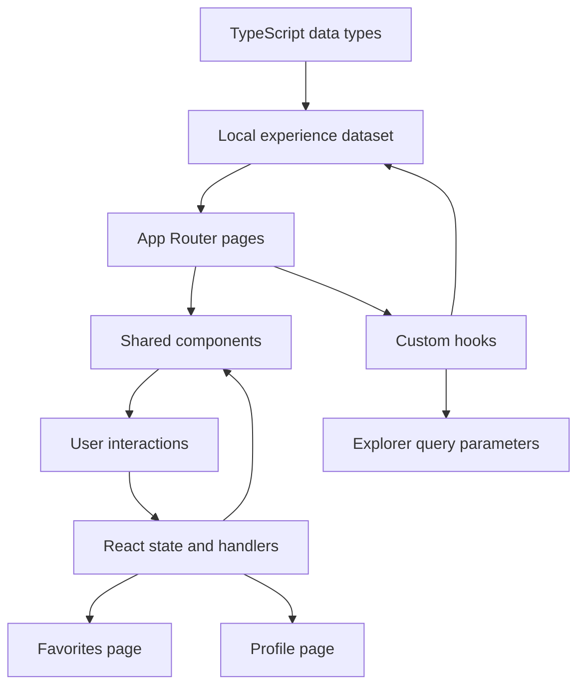
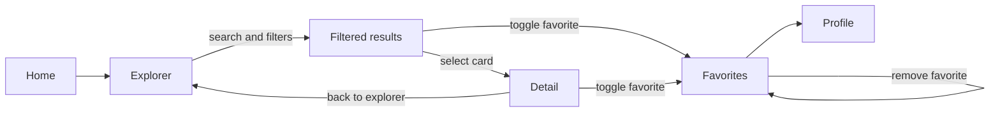

# Wanderlust Explorer — Product and Technical Specification

## 1. Project Overview

**Wanderlust Explorer** is a frontend web application for discovering travel experiences and activities in destinations around the world. It helps travelers browse local experiences—such as food, adventure, culture, wellness, and nature activities—and save interesting options for later.

The project addresses the difficulty of finding and comparing distinctive activities in one place. Its intended audience is people researching things to do while traveling or planning a future trip. The user experience should make discovery, exploration, and comparison straightforward.

Wanderlust Explorer is an **experience-discovery platform**, not a flight or hotel booking platform. It does not process reservations or payments.

## 2. Project Goals

### Product goals

- Discover experiences across multiple categories and destinations.
- Explore the local experience catalogue.
- Search for experiences by title.
- Narrow results by category and destination.
- View the details of an experience.
- Save and remove experiences from favorites.
- Review saved favorites and see a favorite count on the simulated profile.

### Technical and educational goals

- Build a modular frontend with Next.js App Router, React, TypeScript, and Tailwind CSS.
- Demonstrate React state and effects, a meaningful custom hook, reusable components, and props-based data flow.
- Use client-side navigation and URL query parameters to make searches and filters shareable.
- Work with a local dataset rather than a backend or external API.

## 3. Scope

### In Scope

- Five routes: home, experience explorer, experience detail, favorites, and profile.
- A local catalogue of 100 experience records.
- Experience cards and a responsive experience grid.
- Case-insensitive title search.
- Category and destination filters that can be combined with one another and with search.
- Synchronization of explorer controls and results with URL query parameters.
- A detail page selected by experience ID.
- Shared in-memory favorites state, including add/remove controls, a favorites page, and a derived profile count.
- Simulated profile information; no real user account is needed.
- Responsive layouts, basic accessibility, and empty/error states.
- Project README documentation, including the required Design References section.

### Out of Scope

- Backend services, external APIs, or a database.
- Real authentication, registration, or user management.
- Flight or hotel search, booking, reservation, or payment.
- Testimonials, a multi-step travel-planning process, and tailor-made travel services. These appear in the visual reference but are not required product features.
- Experience duration as a data field or card detail. The required dataset model does not define duration, so it must not be inferred or fabricated.
- Persistence of favorites across browser sessions unless an original exercise requirement is later confirmed. `localStorage` is not required and must not be added by default.
- Features beyond those requested in the exercise.

## 4. Technical Stack

### Required stack

- Next.js with the App Router.
- React.
- TypeScript.
- Tailwind CSS.
- React Hooks.
- Next.js route navigation.

The repository currently declares Next.js `16.4.6`, React `19.3.0`, and Tailwind CSS `4.3.3`. These are repository observations, not a requirement to upgrade or add dependencies.

### Technical requirements

- **TR-001:** Use TypeScript for application code and define the experience data shape explicitly.
- **TR-002:** Use `useState` for appropriate interactive UI state.
- **TR-003:** Use `useEffect` where it has a clear purpose in the exercise; do not add an effect solely to satisfy a checklist. A suitable use is synchronizing a local search-input draft when the URL changes externally.
- **TR-004:** Implement at least one meaningful custom hook that encapsulates reusable application logic.
- **TR-005:** Pass data and event handlers through component props where appropriate.
- **TR-006:** Keep favorites state at a level shared by the Navbar, experience cards, detail page, favorites page, and profile.
- **TR-007:** Use Next.js client-side navigation; interactions must not cause full-document reloads.
- **TR-008:** Keep code modular and reusable, and avoid unnecessary dependencies.
- **TR-009:** Do not use Redux, Zustand, or another external state-management library.
- **TR-010:** Keep catalogue data local; do not add a backend, database, or external data API.

## 5. Application Architecture

The application is organized around App Router pages, shared UI components, local data and types, and hooks for reusable filtering or favorites behavior. Page components compose the UI and pass data and callbacks to their children.

The explorer derives its visible results from the local catalogue and active search/filter values. Query parameters provide a shareable representation of explorer state. Favorites are in-memory React state held above all routes that consume it; a built-in React context/provider is a reasonable proposal if the shared layout is the appropriate owner, but no external state library is required.



## 6. Routes and Pages

### `/` — Home

**Purpose:** Introduce the experience-discovery product and lead users into the explorer.

**Required behavior:**

- Present a welcoming hero section and a clear message about discovering travel experiences.
- Provide a call to action that navigates to `/experiences`.
- Share the global navigation.

The exact hero copy, imagery, and content beyond the requested introduction are not specified.

### `/experiences` — Experience Explorer

**Purpose:** Browse, search, and filter the 100 local experiences.

**Required behavior:**

- Render matching experiences in a card grid.
- Provide title search, category selection, and destination selection.
- Apply all active criteria together and update results as the criteria change.
- Read active criteria from `search`, `category`, and `destination` query parameters when the page loads.
- Keep the controls and URL synchronized.
- Show a useful empty state when no experience matches.

Example: `/experiences?search=sailing&category=Adventure&destination=Croatia` should show only records whose title matches “sailing” without regard to letter case, whose category is `Adventure`, and whose destination is `Croatia`. All three conditions apply simultaneously.

### `/experiences/[id]` — Experience Detail

**Purpose:** Show the selected experience, found by its ID in the local dataset.

**Required information and actions:**

- Title, image, full description, category, destination, price, and rating.
- A control to add or remove the experience from favorites.
- Navigation back to the explorer.

If the ID does not match an item in the local dataset, show a clear not-found state (or the framework’s equivalent not-found page) and provide a way to return to the explorer.

### `/favorites` — Favorites

**Purpose:** Display experiences currently saved in shared favorites state.

**Required behavior:**

- Render the saved experiences using the reusable experience card.
- Allow users to remove a favorite and immediately reflect the change.
- Show an empty state when no favorites are saved.

### `/profile` — Profile

**Purpose:** Present a simulated user profile and a summary derived from current application state.

**Required behavior:**

- Show fictional profile information and a basic activity summary.
- Calculate and display the current number of favorites from shared state.
- Do not add authentication or real profile management.

## 7. User Flows

1. **Discover:** Home → Explore Experiences CTA → Experience Explorer.
2. **Search and filter:** Explorer → Enter title query → Choose category → Choose destination → Review combined results.
3. **View details:** Explorer → Select an experience card → Experience Detail → Return to Explorer.
4. **Save a favorite:** Experience card or detail → Toggle favorite → Shared state updates → Open Favorites.
5. **Manage favorites:** Favorites → Remove an item → List and favorite count update immediately.
6. **View profile:** Profile → Read simulated information → See count derived from favorites.



## 8. Functional Requirements

### Navigation

- **FR-001:** Provide the five required routes: `/`, `/experiences`, `/experiences/[id]`, `/favorites`, and `/profile`.
- **FR-002:** Display shared global navigation with links to the main destinations, favorites, and profile.
- **FR-003:** Indicate the active navigation destination where applicable.
- **FR-004:** Use Next.js client-side route navigation without full-page reloads.

### Experience listing

- **FR-005:** Display matching experiences as a responsive grid of reusable cards.
- **FR-006:** Each card displays an image, title, destination, price, rating, and category.
- **FR-007:** Selecting the card’s detail action navigates to `/experiences/[id]` for that experience.
- **FR-008:** Each card exposes an accessible favorite toggle.

### Search

- **FR-009:** Search experience titles using the `search` value.
- **FR-010:** Match titles case-insensitively.
- **FR-011:** Show an appropriate empty state when no title matches.

### Filters

- **FR-012:** Filter by one category selected from `Adventure`, `Culture`, `Food`, `Wellness`, and `Nature`.
- **FR-013:** Filter by destination values represented in the local dataset.
- **FR-014:** Combine search, category, and destination criteria using AND semantics: each visible record must satisfy every active criterion.
- **FR-015:** Update the displayed results when a criterion changes.

### URL synchronization

- **FR-016:** Represent explorer state with the `search`, `category`, and `destination` query parameters.
- **FR-017:** Initialize the explorer controls and results from query parameters on direct load or reload.
- **FR-018:** Update the URL as the user changes explorer criteria, without a full-document navigation.
- **FR-019:** Preserve other active criteria when one criterion changes, and omit empty criteria from the URL.
- **FR-020:** Allow a copied explorer URL to restore the same valid search and filter state.

### Experience detail

- **FR-021:** Resolve the requested experience using its ID in the local dataset.
- **FR-022:** Render the complete required experience information and favorite action.
- **FR-023:** Handle an unknown ID with a clear not-found state and a return path to the explorer.

### Favorites

- **FR-024:** Allow a user to add an experience to favorites.
- **FR-025:** Allow a user to remove an experience from favorites.
- **FR-026:** Make favorites state available consistently to the Navbar, cards, detail, favorites, and profile views.
- **FR-027:** Reflect favorite changes immediately in all consumers, including any favorite count.
- **FR-028:** Show an empty state on `/favorites` when the saved list is empty.

### Profile

- **FR-029:** Display fictional profile information without authentication.
- **FR-030:** Derive the displayed favorite count from the current shared favorites state.

### Responsive behavior

- **FR-031:** Keep navigation, search, filters, cards, and page layouts usable on mobile, tablet, and desktop viewports.
- **FR-032:** Prevent horizontal overflow and preserve access to all essential controls on narrow viewports.

## 9. Dataset and Data Model

The application uses a local dataset containing **100 experiences**. It must not depend on an external API. The dataset file is present in the repository, but its contents could not be verified because access was restricted; confirm its record count, shape, and category/destination coverage during implementation.

### Experience model

| Property | Type | Meaning and integrity expectation |
|---|---|---|
| `id` | `string` | Stable, non-empty identifier unique within the dataset; used by the detail route and favorites. |
| `title` | `string` | Non-empty display title and search field. |
| `description` | `string` | Description shown on the detail page. |
| `category` | `ExperienceCategory` | Exactly one of `Adventure`, `Culture`, `Food`, `Wellness`, or `Nature`. |
| `destination` | `string` | Non-empty destination name and destination-filter value. |
| `price` | `number` | Non-negative numeric price; currency and display format are not specified and must be confirmed or clearly treated as a presentation proposal. |
| `rating` | `number` | Numeric rating; the permitted scale and precision are not defined in the available requirements and should be confirmed against the exercise/data. |
| `imageUrl` | `string` | Non-empty image source; use meaningful alternative text derived from the experience. The image source may be local or otherwise already present, but no external API is permitted. |

`ExperienceCategory` is the union of the five valid category values above. Dataset IDs must be unique, every record must satisfy the model, and category values must be valid. Destination filter options should be derived from values actually present in the dataset rather than invented.

The detail route looks up an experience by its `id`. Favorites should refer to stable IDs (or equivalent records resolved from those IDs) so cards, detail, and profile remain consistent.

## 10. State Management

- **Search state:** The active query is represented in the explorer URL and reflected in the controlled search field.
- **Filter state:** Active category and destination are represented in the URL and in their respective controls.
- **Results:** Derived from the local dataset and the active search/filter values; do not maintain a second independently mutable copy of filtered results.
- **Favorites:** Keep shared in-memory state high enough in the component tree for Navbar, experience cards, detail, favorites, and profile to consume and update it. A provider built with React’s built-in context is a proposal if ordinary props would cause excessive drilling; external state libraries are prohibited.
- **Favorite count:** Derive from the current favorites collection rather than maintaining a separately updated count.
- **Props:** Use props for experience data, current favorite status, and interaction callbacks between shared components and pages.
- **Persistence:** No cross-session persistence is required. Do not add `localStorage` unless a source requirement is later found.

## 11. URL and Query Parameters

The explorer uses these optional parameters:

| Parameter | Meaning |
|---|---|
| `search` | Case-insensitive substring query applied to experience titles. |
| `category` | Exact category filter using one of the five valid categories. |
| `destination` | Exact destination filter using a destination represented in the dataset. |

Example: `/experiences?search=vela&category=Adventure&destination=Croatia` combines all three criteria; the results must match all of them.

Requirements:

- Read parameters through the Next.js App Router’s supported URL/search-parameter mechanisms.
- Initialize the visible input/select controls and result set from the current URL, including direct links.
- On a control change, update that parameter while retaining the other active parameters.
- Use client-side URL updates; do not submit a full-page form navigation or reload the document.
- Treat missing or whitespace-only parameters as inactive and omit them from the URL.
- Invalid category or destination values must not break rendering. The exact normalization policy (ignore invalid value, clear it, or show validation feedback) is not fixed by the exercise and should be confirmed; whichever policy is chosen must keep results and controls consistent.
- Search matching is case-insensitive. Whether category/destination comparison should also ignore case is not specified; use canonical dataset values for filter options and document any normalization decision.
- No debounce duration is prescribed. If typing is debounced, treat the delay as a proposal and ensure the URL and controlled field do not become inconsistent.

## 12. Components

| Component | Responsibility | Main props / state | Interactions and dependencies |
|---|---|---|---|
| `Navbar` | Shared global navigation, active route indication, links to favorites/profile, and optional favorite indicator. | Active route and favorite count/status supplied by its parent/shared state. | Uses Next.js links; reads shared favorites data or receives it via props. |
| `ExperienceCard` | Present a concise experience summary and provide entry points to detail and favorites. | `experience`, favorite status, favorite-toggle callback. | Uses Next.js navigation; displays image, title, destination, price, rating, and category. |
| `Searchbar` | Provide an accessible title-search input. | Current query and change callback; local draft state only if needed. | Controlled by explorer state/URL; label must be programmatically associated. |
| `Filterbar` | Provide category and destination selection. | Current values, available valid options, and change callbacks. | Options derive from the defined categories and local dataset; changes preserve the other criteria. |

Additional components such as a results grid, empty-state view, or shared page container are optional only where they create a clear reusable responsibility. Avoid creating components without a distinct role.

## 13. Custom Hooks

At least one meaningful custom hook is required. The following are coherent options; implement only what the app needs.

| Hook | Inputs | Returns | Responsibility |
|---|---|---|---|
| `useExperiences` | Local dataset and active criteria (or access to explorer URL state). | Filtered experiences and, if useful, available destinations. | Encapsulate the single source of search/filter logic to prevent duplicate filtering rules. |
| `useFavorites` | Shared favorites state/provider, if used. | Favorite IDs/items, count, `isFavorite`, add, and remove/toggle operations. | Provide consistent favorite behavior to all consuming components. |
| `useFilters` | Current query parameters and router utilities. | Current values and update handlers. | Optionally encapsulate URL synchronization; avoid duplicating route logic across controls. |

These are architectural responsibilities, not implementation instructions requiring all three hooks.

## 14. UI and UX Requirements

- Use a clean, modern interface focused on discovering travel experiences.
- Establish clear visual hierarchy and consistent patterns across all routes.
- Make experience cards reusable and provide clear actions for details and favorites.
- Make navigation and filters intuitive and provide visible feedback when favorites change.
- Provide empty and not-found states instead of blank content.
- Ensure that controls have visible focus and selected states.
- Treat `sryle-reference/DESIGN-tourismo.md` and `sryle-reference/home-turismo.jpg` as visual references for style and composition, not as literal product-content requirements. The screenshot depicts Nepal; the application must represent the experiences and destinations in its own local dataset rather than being presented as a Nepal-only service.
- Use the canonical palette: deep midnight navy (`#07111E`) as the primary color, expedition cerulean (`#2563EB`) as the secondary accent, alpine slate (`#475569`) for supporting text, and mist white (`#F8F9FA`) as the light canvas. Where the design guide's token header conflicts with its descriptive palette, these canonical values take precedence.
- Use Plus Jakarta Sans for structural typography and selective italic Playfair Display accents for editorial emphasis. Use uppercase, letter-spaced micro-labels where appropriate.
- Favor generous whitespace and editorial section spacing; use a constrained, fluid content width and responsive column layouts. The reference's 4-column mobile, 8-column tablet, and 12-column desktop grid is guidance, not a requirement for every component.
- Use immersive destination/experience imagery, rounded image cards, restrained bottom gradients for text over imagery, and subtle frosted-glass pills or badges where they improve legibility. Prefer fine borders and soft ambient shadows over heavy shadows.
- Style primary and inverted actions as rounded pill buttons; use rounded category labels and compact circular icon controls where appropriate.
- Apply this visual language to the required routes and components without introducing unrequested content sections. Do not add testimonials, travel-process steps, or tailor-made services. Do not display duration on experience cards unless it is later added to the authoritative requirements and verified in the dataset.
- Do not invent brand assets, copy, or imagery not present in the project. The visual reference does not authorize adding product features.

## 15. Responsive Requirements

### Mobile

- Adapt the navbar to the available width.
- Keep search and filters accessible and usable.
- Use a reduced-column card grid and optimize card content for narrow screens.
- Prevent horizontal overflow.

### Tablet

- Use an intermediate grid and balanced content distribution.
- Adapt navigation and filters to available space.

### Desktop

- Use a multi-column grid and make effective use of the available content width.
- Present full navigation and a clear, spacious content layout.

Do not introduce custom breakpoint values without a need. Existing Tailwind defaults may be used as a proposal. The design reference describes 4-column mobile, 8-column tablet, and 12-column desktop layout concepts; those are guidance, not a requirement to implement a literal CSS grid in every component.

## 16. Error and Empty States

- **No search/filter results:** Explain that no experiences match and provide a straightforward way to clear or adjust criteria.
- **No favorites:** Explain that the list is empty and provide a link to explore experiences.
- **Unknown experience ID:** Show a not-found message and a route back to the explorer.
- **Invalid query parameter:** Apply the documented invalid-value policy without crashing or presenting a state that disagrees with the URL.
- **Empty dataset:** Render a meaningful no-experiences state; the dataset acceptance check should still fail if the required 100 records are absent.
- **Image load failure:** Keep the card/detail layout usable and provide an appropriate fallback or neutral placeholder. Do not leave broken layout or inaccessible image content.

## 17. Accessibility Requirements

- Use semantic HTML landmarks, headings, lists, and links/buttons according to their purpose.
- Ensure all navigation and interactive controls are keyboard-operable with visible focus.
- Associate labels with search and filter inputs.
- Provide sufficient text/background contrast.
- Give meaningful images appropriate alternative text; use empty alternative text only for decorative imagery.
- Give favorite buttons accessible names that describe the action and current state.
- Expose state with text or accessible attributes, not color alone.
- Maintain logical heading order and preserve readable content when layouts reflow.

## 18. Project Structure

The following is a proposed App Router-aligned structure. Adapt it to existing conventions and avoid unnecessary files.

```text
src/
  app/
    layout.tsx
    page.tsx
    experiences/
      page.tsx
      [id]/
        page.tsx
    favorites/
      page.tsx
    profile/
      page.tsx
  components/
    Navbar.tsx
    ExperienceCard.tsx
    Searchbar.tsx
    Filterbar.tsx
  data/
    experiences.ts
  hooks/
    useExperiences.ts
    useFavorites.ts
  types/
    experience.ts
```

The existing repository already has `src/app` and `src/data`. The structure above describes likely destinations for required responsibilities; it does not assert that every listed file already exists or must be created exactly as named.

## 19. Implementation Constraints

- Do not develop a backend, consume an external API, or add a database.
- Do not implement authentication or real user management.
- Do not implement booking, reservations, or payments.
- Do not use Redux or Zustand; do not add an unnecessary state-management dependency.
- Use TypeScript and the existing Next.js App Router, React, and Tailwind CSS stack.
- Prefer reusable components and a modular separation of data, logic, and presentation.
- Use Next.js navigation and avoid full-page reloads.
- Keep filtering/search logic and favorite logic centralized rather than duplicating it.
- Do not add functionality outside the agreed scope.
- Do not add favorite persistence unless an authoritative exercise source requires it.
- Do not invent design-reference URLs; document missing references as pending.

## 20. Acceptance Criteria

- [ ] `/` renders a working home page with a clear CTA to `/experiences`.
- [ ] Shared navigation links to the required routes and indicates the active route where applicable.
- [ ] `/experiences` renders the local experience catalogue as cards.
- [ ] The dataset contains exactly 100 valid experience records with unique IDs.
- [ ] Each card shows image, title, destination, price, rating, and category and links to the correct detail.
- [ ] Searching matches titles without regard to letter case.
- [ ] Category filtering works for all five valid categories.
- [ ] Destination filtering uses values present in the dataset.
- [ ] Search, category, and destination filters can be combined, and only records matching every active criterion are shown.
- [ ] No-match results display a useful empty state.
- [ ] Changing explorer controls updates query parameters without a full-page reload.
- [ ] Loading a URL with valid query parameters initializes the controls and results consistently.
- [ ] Empty query parameters are treated as inactive and do not remain unnecessarily in the URL.
- [ ] `/experiences/[id]` displays all required fields for a valid ID.
- [ ] An unknown detail ID displays a clear not-found state and a route back to the explorer.
- [ ] Favorites can be added from a card and/or detail view and removed from the favorites list.
- [ ] Favorite state is shared consistently across the Navbar, cards, detail, favorites, and profile.
- [ ] Favorite changes immediately update relevant controls, lists, and count.
- [ ] `/favorites` displays saved experiences or an empty state when none are saved.
- [ ] `/profile` displays simulated information and a favorite count derived from current state.
- [ ] `useState` is used for suitable interactive state, `useEffect` is used where justified, and at least one meaningful custom hook is present.
- [ ] Components communicate through appropriately typed props and reusable UI is not needlessly duplicated.
- [ ] The implementation uses TypeScript and the existing required stack without Redux, Zustand, or unnecessary dependencies.
- [ ] Mobile, tablet, and desktop layouts remain usable and have no horizontal overflow.
- [ ] Navigation between internal routes does not trigger full-document reloads.
- [ ] Basic keyboard, semantic HTML, labels, image alternatives, focus, contrast, and favorite-button accessibility requirements are met.
- [ ] The implemented visual treatment follows the canonical palette (`#07111E` primary, `#2563EB` secondary) and the documented editorial, responsive, image-card, and pill-control direction without copying Nepal-specific content.
- [ ] Testimonials, travel-process steps, tailor-made services, and unsupported duration data have not been added as product features.
- [ ] The README describes how to run the project and contains a `## Design References` section.
- [ ] The README section contains 2–3 real design-reference URLs once selected; until then, selection is explicitly marked pending and no URLs are fabricated.

## 21. Design References

The repository contains `sryle-reference/DESIGN-tourismo.md` and `sryle-reference/home-turismo.jpg`. They provide a visual direction and a page-composition example for the “Serene Editorial Expedition” style. The screenshot's Nepal-specific content is illustrative only; it is not a requirement to use Nepal as the sole destination or to reproduce its literal copy and sections.

The canonical palette for this project is primary deep midnight navy (`#07111E`) and secondary expedition cerulean (`#2563EB`), with alpine slate (`#475569`) and mist white (`#F8F9FA`) as supporting colors. These values take precedence over conflicting color values in the reference document's token header.

The screenshot also contains testimonials, a travel-process section, and tailor-made services. These are **not included** as product features because they are outside the stated exercise scope. It includes duration badges on some tour cards, but duration is **not part of the required experience model** and must not be shown or fabricated unless a source requirement and dataset support it.

The exercise separately requires the README to include a `## Design References` section with **2–3 real web design references**. Those external references have not been verified or selected in the available materials. Mark them as pending in the README until confirmed; do not invent URLs.

## 22. Development Phases

1. **Phase 1 — Project Setup:** Confirm existing app conventions, requirements, and project structure. Avoid unrelated configuration changes.
2. **Phase 2 — Data and Types:** Verify the local catalogue, its 100-record count, category values, unique IDs, and TypeScript model.
3. **Phase 3 — Shared Components:** Build the shared Navbar, ExperienceCard, Searchbar, and Filterbar responsibilities.
4. **Phase 4 — Experience Explorer:** Implement listing, title search, category/destination filtering, combined results, URL initialization, and URL updates.
5. **Phase 5 — Experience Details:** Implement ID-based lookup, full details, favorite action, back navigation, and unknown-ID handling.
6. **Phase 6 — Favorites:** Add shared in-memory favorites state and ensure consistent immediate updates across consumers.
7. **Phase 7 — Profile:** Add the simulated profile and a favorite count derived from shared state.
8. **Phase 8 — Responsive and UI Refinement:** Align with the design reference, responsive behavior, accessibility, image fallback, and empty/error states.
9. **Phase 9 — Validation and Documentation:** Verify acceptance criteria, run applicable checks, update the README, and add confirmed design-reference URLs.
